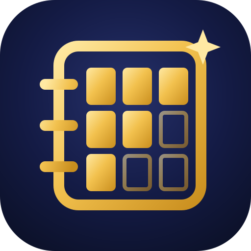

  

<h1 align="center">Binder Tracker</h1>

<a href="https://bindertracker.co.uk/"><b>bindertracker.co.uk</b></a>

## About

Binder Tracker is a free checklist site for Pokémon TCG collectors, with no ads, no sign-up and no tracking. It covers every English set from Base Set (1999) to Mega Evolution, including subsets, Black Star promos, Basic Energy, trainer kits, McDonald's collections, POP Series, World Championships Decks and Prize Packs. Each set has its own page in colours that match the set, with card images, rarities, prices and binder pages.

Your collection is saved in your own browser, and the site works offline once you've added it to your home screen. It's a static site built with plain HTML, CSS and JavaScript, with no backend.

## Features

- Standard, Master and Grand Master tiers for every set, including reverse holos, patterns and 1st Editions
- Grid, list and binder page views, with copy counts for duplicates
- Quick add for marking lots of cards at once, with undo
- A card scanner that recognises cards through your camera, on your device
- Collection value and cost to complete, from TCGplayer market prices
- Trade codes and trade lists for comparing collections with friends
- Export or share a set, chosen sets or your whole collection, and import one, by link, code, QR code or file
- A page to view a collection someone sends you, or compare it side by side with your own
- Works offline and installs to your home screen, with light and dark themes

## Privacy

The site sets no cookies and has no analytics or trackers. Your collection stays in your browser, and scanner photos are processed on your device and never uploaded. Most card images load from TCGdex. Full details are in the [privacy policy](https://bindertracker.co.uk/privacy.html).

## Licence and credits

The code is released under the [MIT Licence](LICENSE). That doesn't cover:

- Pokémon card images, names and logos, which belong to their owners
- card data from [TCGdex](https://tcgdex.dev), and prices from TCGplayer via [tcgcsv.com](https://tcgcsv.com)
- the Outfit font ([SIL Open Font License](public/fonts/OFL.txt))
- `qrcode.js` (MIT, © Kazuhiko Arase)
- jsQR ([Apache License 2.0](public/js/vendor/jsqr/LICENSE))
- ONNX Runtime Web ([MIT](public/js/vendor/ort/LICENSE), © Microsoft)
- the card scanner's DINOv2-small model by Meta AI (Apache License 2.0, see [LICENSE](public/data/scan/LICENSE) and [NOTICE](public/data/scan/NOTICE))

## Legal

Binder Tracker is an unofficial fan project. It is not affiliated with, endorsed, sponsored or approved by Nintendo, Creatures Inc., GAME FREAK inc. or The Pokémon Company. Pokémon and all card images are © Pokémon / Nintendo / Creatures Inc. / GAME FREAK inc.
